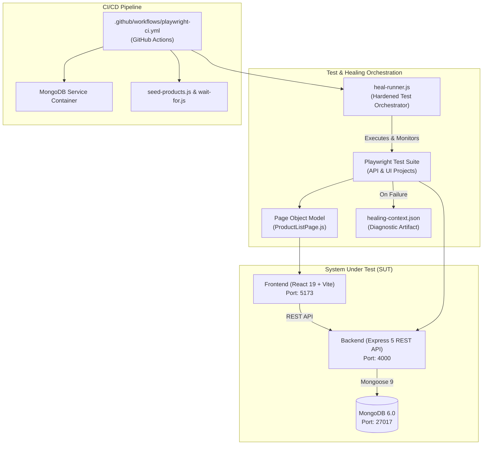

# E-Commerce SDET Platform & AI Self-Healing Test Automation

A full-stack e-commerce web application featuring RESTful APIs, a React single-page frontend, MongoDB persistence, and an enterprise-grade Playwright end-to-end test automation framework equipped with an **Autonomous AI Self-Healing Protocol** and **GitHub Actions CI/CD**.

---

## Architecture Overview



---

## Key Features

### 1. System Under Test (SUT)
- **Frontend**: React 19 single-page application built with Vite and React Router v7. Includes interactive product catalog viewing, item creation, and responsive layout.
- **Backend**: Node.js & Express 5 REST API exposing endpoints for product creation, retrieval, updates, and deletion (`/api/products`).
- **Database**: MongoDB 6 with Mongoose 9 ODM models enforcing data validation.

### 2. Playwright Test Automation
- **Dual Projects**: Configured in `playwright.config.js` with isolated projects:
  - `api`: Fast REST API tests validating status codes, CRUD operations, and error handling.
  - `ui`: End-to-end browser tests running on Chromium with automatic failure screenshots and trace capture (`retain-on-failure`).
- **Page Object Model (POM)**: Robust UI abstraction layer (`tests/pages/ProductListPage.js`) leveraging user-facing, accessible Playwright locators (`getByRole`, `getByLabel`).
- **Test Fixtures & Data**: Self-cleaning product fixtures (`tests/fixtures/product.fixture.js`) and structured test datasets (`tests/test-data/product.data.js`).

### 3. Hardened AI Repair Orchestrator (`scripts/heal-runner.js`)
An intelligent test runner that executes Playwright and generates standardized diagnosis context upon failures:
- **Non-Destructive Report Preservation**: Backs up prior reports (`results.json.bak`) and restores them if a run is aborted or fails before reporter completion.
- **Report Freshness Guarantee**: Validates filesystem timestamps to ensure stale reports from prior runs are never mistaken for current outcomes.
- **Observed Symptom Classification**: Distinguishes `LOCATOR_LOOKUP_TIMEOUT`, `ASSERTION_MISMATCH`, `ENVIRONMENT_CONNECTION_ERROR`, and `CODE_EXCEPTION` without jumping to premature conclusions.
- **Strict Locator Extraction**: Conservative regex extraction that captures standard and role-based locators while returning `null` (never guessing) for non-locator failures.
- **Exit Code Fidelity**: Preserves Playwright's authentic exit codes and separates orchestration errors from test assertion failures.
- **Antigravity AI Repair Handoff**: Automatically produces `test-results/healing-context.json` and outputs a standardized AI handoff banner for interactive debugging sessions.

### 4. Self-Healing Protocol (`GEMINI.md`)
Governs AI-driven test maintenance and self-healing with strict safety constraints:
1. **Execution & Failure Ingestion**: Parses JSON failure traces and error stacks.
2. **Multi-Vector Failure Investigation**: Live inspection of network traffic, console errors, and DOM state via Playwright MCP.
3. **Four-Way Root Cause Classification**:
   - `STALE_LOCATOR`: Element exists in DOM but selector evolved $\rightarrow$ proceed with POM locator repair.
   - `APPLICATION_DEFECT`: Feature missing or API 5xx $\rightarrow$ abort healing, report application defect.
   - `TEST_DATA_ISSUE`: Missing seed entity $\rightarrow$ report test data prerequisite mismatch.
   - `ENVIRONMENT_ISSUE`: Offline service or connection refused $\rightarrow$ report environment outage.
4. **Mandatory Human Review Gate**: Changes require explicit human review and approval; zero unprompted Git commits or pushes.

### 5. GitHub Actions CI/CD Pipeline (`.github/workflows/playwright-ci.yml`)
Fully automated CI pipeline designed for zero-flakiness execution:
- **Triggers**: Automated runs on push and pull requests to `main` and `feature/product-crud`, plus manual execution via `workflow_dispatch`.
- **MongoDB Service**: Boots a containerized MongoDB 6 instance with Docker health checks.
- **Service Readiness Poller (`scripts/wait-for.js`)**: Universal cross-platform poller utilizing native Node.js `fetch` to ensure both Backend and Frontend are listening before test execution.
- **Automated Catalog Seeding (`scripts/seed-products.js`)**: Idempotently seeds expected catalog products into fresh databases.
- **Comprehensive Artifact Upload**: Automatically uploads HTML reports, JSON outputs, traces, screenshots, and `healing-context.json` on both success and failure.

---

## Project Structure

```text
ecommerce-sdet-platform/
├── .github/
│   └── workflows/
│       └── playwright-ci.yml      # GitHub Actions CI workflow
├── backend/                       # Express REST API & Mongoose models
│   ├── src/
│   │   ├── config/database.js     # MongoDB connection setup
│   │   ├── controllers/           # Product controllers
│   │   ├── models/                # Mongoose product schema
│   │   └── routes/                # API route definitions
│   └── server.js                  # Backend entry point (Port 4000)
├── frontend/                      # React 19 + Vite frontend (Port 5173)
│   ├── src/                       # Components, pages, and styling
│   └── vite.config.js             # Vite configuration
├── scripts/
│   ├── heal-runner.js             # Hardened Playwright test runner & context generator
│   ├── seed-products.js           # Idempotent catalog test data seeder
│   ├── verify-stage2-1.js         # Unit regression test suite for heal-runner
│   └── wait-for.js                # Universal HTTP service readiness poller
├── tests/
│   ├── api/products/              # Playwright API test specs
│   ├── fixtures/                  # Playwright reusable test fixtures
│   ├── pages/                     # Page Object Model classes
│   ├── test-data/                 # Reusable test payloads
│   ├── ui/                        # Playwright UI end-to-end test specs
│   └── utils/                     # Heuristic recovery PoC utility
├── GEMINI.md                      # Antigravity Self-Healing Protocol
├── playwright.config.js           # Playwright configuration (projects, reporters)
└── package.json                   # Root dependencies and test scripts
```

---

## Getting Started

### Prerequisites
- **Node.js**: v20+ LTS recommended
- **MongoDB**: Local MongoDB instance running on port `27017` (or Docker)

### Installation

Clone the repository and install dependencies across all workspaces:

```bash
# 1. Install root dependencies (Playwright test runner)
npm install

# 2. Install Playwright browser binaries
npx playwright install --with-deps chromium

# 3. Install backend dependencies
npm install --prefix backend

# 4. Install frontend dependencies
npm install --prefix frontend
```

---

## Running the Application Locally

### 1. Start MongoDB
Ensure MongoDB is running locally on `localhost:27017`:
```bash
# Example with Docker:
docker run -d -p 27017:27017 --name mongodb mongo:6
```

### 2. Start the Backend API
```bash
npm start --prefix backend
# Server will run on http://localhost:4000
```

### 3. Seed the Test Catalog
```bash
node scripts/seed-products.js
```

### 4. Start the Frontend Application
```bash
npm run dev --prefix frontend
# Frontend will run on http://localhost:5173
```

---

## Executing Tests

### Run All Tests via Hardened Orchestrator
Executes both API and UI test suites while capturing diagnostic failure contexts:
```bash
npm run test:heal -- --project=api --project=ui
```

### Run Specific Test Projects
```bash
# Run only API tests
npx playwright test --project=api

# Run only UI tests
npx playwright test --project=ui

# Run UI tests with the orchestrator
npm run test:heal -- tests/ui/product-list.spec.js
```

### Verify Test Orchestrator Unit Behaviors
To run the built-in regression test suite for the orchestrator (validating symptom classification, locator extraction, and report freshness):
```bash
node scripts/verify-stage2-1.js
```

### Viewing Test Reports
After running tests, open the interactive HTML Playwright report:
```bash
npx playwright show-report
```

---

## CI/CD Workflow Overview

The GitHub Actions workflow (`.github/workflows/playwright-ci.yml`) automatically performs the following steps on every push and pull request:
1. Spawns a **MongoDB 6.0** Docker service container.
2. Installs root, backend, and frontend dependencies reproducibly using `npm ci`.
3. Installs Chromium and system libraries.
4. Starts the backend server and polls `http://localhost:4000/api/products` using `scripts/wait-for.js`.
5. Idempotently seeds the catalog using `scripts/seed-products.js`.
6. Starts the frontend server and polls `http://localhost:5173` using `scripts/wait-for.js`.
7. Executes API and UI test suites using `npm run test:heal`.
8. Uploads HTML reports, JSON logs, traces, screenshots, and `healing-context.json` as build artifacts.

---

## License

ISC License.
