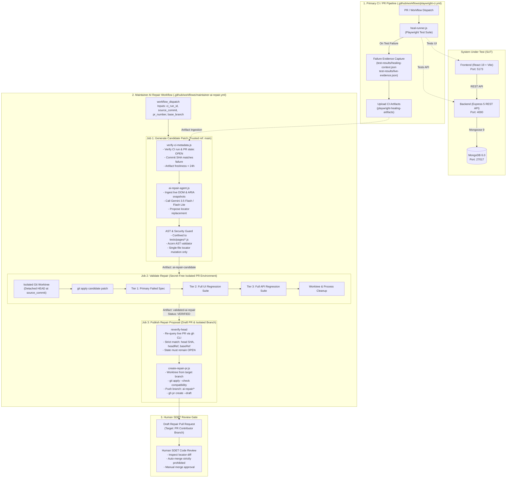

# E-Commerce SDET Platform & Autonomous AI Self-Healing Test Automation

A full-stack e-commerce web application featuring RESTful APIs, a React single-page frontend, MongoDB persistence, and an enterprise-grade Playwright end-to-end test automation framework equipped with an **Autonomous AI Self-Healing Protocol**, an isolated **Maintainer Repair Pipeline**, and **GitHub Actions CI/CD**.

---

## 1. Architecture Overview



---

## 2. Component Roles & Tools

| Component / Tool | Primary Responsibility | Security & Architectural Constraints |
|:---|:---|:---|
| **Playwright** | Executes UI (`chromium`) and API test suites. Captures traces, failure screenshots, and execution logs. | Configured via `playwright.config.js`. Dual projects (`api`, `ui`) run independently. |
| **Page Object Model (POM)** | Centralizes UI selectors and user interactions (`tests/pages/ProductListPage.js`). | UI tests reference POM accessors; raw selectors are never embedded directly inside test specs. |
| **GitHub Actions** | Orchestrates continuous integration (`playwright-ci.yml`) and isolated repair validation (`maintainer-ai-repair.yml`). | Job separation ensures credentials and privileged tokens are never accessible to untrusted candidate code. |
| **Gemini AI Model** | Analyzes DOM snapshots and ARIA accessibility trees to hypothesize replacement locators. | Invoked via `@google/genai` with primary (`gemini-3.5-flash`) and fallback (`gemini-3.5-flash-lite`) models. Cannot execute arbitrary code or guess without evidence. |
| **AST & Diff Validators** | Parses patches with `acorn` and validates unified diffs against source code. | Strictly enforces single-file edits inside `tests/pages/*.js`. Rejects control flow, assertions, function renaming, and process/exec calls. |
| **Git Worktrees** | Provides detached, filesystem-level isolation for patch application and test execution. | Prevents patch application or compilation side-effects from mutating the primary checkout or working tree. |
| **GitHub CLI (`gh`)** | Queries live PR metadata and publishes draft pull requests. | Strictly audited in `validateCommandSafety`. Auto-merge subcommands (`gh pr merge`) are hard-blocked with an immediate security violation. |
| **Workflow Artifacts** | Bridges candidate patches and validation summaries between isolated jobs. | Transfers `ai-repair-candidate` and `validated-ai-repair` across job boundaries without exposing environment variables or secrets. |

### Local Diagnostic Handoff vs. Cloud Maintainer Workflow

It is critical to distinguish between the two layers of the self-healing implementation:

1. **Local Diagnostic Handoff (`scripts/heal-runner.js`)**:
   - Executes during daily development and standard CI runs (`playwright-ci.yml`).
   - Collects test outcomes, classifies failure symptoms, captures live DOM/accessibility snapshots (`live-evidence.json`), and writes `healing-context.json`.
   - **Does NOT** call Gemini, does not alter Git branches, and does not push code. It packages standardized evidence for maintainers.
2. **Cloud Maintainer Repair Workflow (`.github/workflows/maintainer-ai-repair.yml`)**:
   - Manually dispatched by maintainers using a failed CI run ID and source commit SHA.
   - Operates across 3 distinct jobs: **Generate** (Gemini + AST validation) $\rightarrow$ **Validate** (secret-free 3-tier regression in an isolated worktree) $\rightarrow$ **Publish** (creates an isolated branch and opens a draft PR).
   - Constrained by deterministic gates, strict source lineage, and a mandatory human review gate.

---

## 3. The 11-Step Self-Healing Lifecycle

The autonomous repair pipeline follows a disciplined, 11-step verification lifecycle:

```text
 1. CI Run Fails ──► 2. Artifacts Uploaded ──► 3. Workflow Dispatched ──► 4. Metadata Verified
                                                                                  │
 8. 3-Tier Validation ◄── 7. Secret-Free Worktree ◄── 6. AST & Safety Gates ◄── 5. Gemini Proposes Patch
        │
        ▼
 9. Re-Verify PR Lineage ──► 10. Isolated Branch & Draft PR ──► 11. Human SDET Review (No Auto-Merge)
```

1. **Playwright CI Failure**: A standard pull request or push run fails in `.github/workflows/playwright-ci.yml`.
2. **Evidence Packaging**: `scripts/heal-runner.js` and `scripts/capture-evidence.js` generate `test-results/healing-context.json` and `test-results/live-evidence.json` (containing sanitized DOM and accessibility trees). These are uploaded as `playwright-healing-artifacts`.
3. **Maintainer Dispatch**: A repository maintainer triggers `.github/workflows/maintainer-ai-repair.yml` via `workflow_dispatch`, specifying the failed run ID, exact 40-character source commit SHA, PR number, and base branch.
4. **Metadata & Lineage Verification**: Step `verify-ci-metadata.js` queries GitHub API to ensure:
   - The CI run failed on a supported event (`pull_request`, `push`, `workflow_dispatch`).
   - The PR is currently `OPEN`.
   - The live PR head SHA matches `source_commit`.
   - The artifacts are fresh (< 24 hours old) and contain valid DOM evidence.
   - The target Page Object Model exists at `source_commit`.
5. **AI Candidate Generation**: `scripts/ai-repair-agent.js` invokes Gemini in `--generate-only` mode. Gemini correlates the failing locator against the live DOM and ARIA snapshots and outputs a candidate unified diff patch (`repair.patch`).
6. **Deterministic AST & Security Filtering**: Before the patch leaves Job 1, `validatePatchAst` parses the patch using `acorn`:
   - Enforces single-file target confinement (`tests/pages/*.js`).
   - Prohibits executable side-effects, loops, function renames, assertions, and dynamic code evaluation (`eval`, `Function`).
   - Validates that removed lines match the source commit file content line-for-line.
7. **Secret-Free Worktree Hand-off**: Job 2 (`validate-repair`) starts with **zero secrets** (`GEMINI_API_KEY` is not exposed). It checks out `source_commit`, creates an isolated Git worktree (`../validation-workspace`), and applies the candidate patch with `git apply`.
8. **Three-Tier Verification Suite**: The patched worktree executes three verification gates:
   - **Tier 1 (Target Spec)**: Executes the exact failing UI test spec (`npx playwright test <spec> --project=ui`).
   - **Tier 2 (UI Regression)**: Executes the full UI regression suite (`--project=ui`) to guarantee no regressions in other locators.
   - **Tier 3 (API Regression)**: Executes the full API regression suite (`--project=api`) to confirm backend contract stability.
   Upon 100% passage, the summary status is marked `VERIFIED`, and `validated-ai-repair` is uploaded.
9. **Pre-Publish Lineage Re-Verification**: Job 3 (`publish-repair`) runs on trusted `main`. Step `reverify-head` queries the live PR via `gh pr view` and strictly verifies:
   - State is still `OPEN`.
   - Live head SHA is still `$SOURCE_COMMIT`.
   - Live head branch matches `$EXPECTED_HEAD_BRANCH`.
   - Live base branch matches `$EXPECTED_BASE_BRANCH`.
   If any branch or SHA mutated during validation, publishing aborts immediately.
10. **Isolated Branch Creation & Draft PR Proposal**: `scripts/create-repair-pr.js` determines the target base branch (`TARGET_BASE="${HEAD_BRANCH:-$BASE_BRANCH}"`), creates an isolated worktree from that ref, verifies patch compatibility with `git apply --check`, commits the change, pushes an `ai-repair/*` branch, and opens a draft PR using `gh pr create --draft`.
11. **Mandatory Human Review Gate**: Auto-merge is strictly prohibited (`gh pr merge` is blocked in code and repository settings). A human SDET reviews the draft PR diff, inspects the verification report, and merges manually.

### Authority & Boundaries Matrix

| Decision / Action | Governed By | Authority & Constraints |
|:---|:---|:---|
| **Locator Hypothesis** | Gemini 3.5 Flash / Flash Lite | Analyzes observed DOM evidence to suggest a semantic locator replacement. **Cannot** alter test assertions or backend logic. |
| **Patch Confinement & AST Safety** | `scripts/ai-repair-agent.js` | Deterministic Acorn AST parser. Strictly enforces single POM modifications and rejects unauthorized statements. |
| **Source Lineage & PR Integrity** | `scripts/verify-ci-metadata.js` | Deterministic GitHub API checks. Fails if PR state, head SHA, base branch, or artifact freshness criteria are violated. |
| **Functional Correctness Proof** | Playwright Test Suite | Executes Tier 1 (target spec), Tier 2 (UI regression), and Tier 3 (API regression). A patch is invalid if any assertion fails. |
| **Final Merge Decision** | Human SDET / Maintainer | Retains ultimate authority. Reviews draft PR diff, test execution summaries, and approves merging. Zero automated merging. |

> [!IMPORTANT]
> This framework produces **strictly constrained, verified repair proposals**, not unrestricted self-modifying code. The AI never commits directly to branches, never touches application source code, and never bypasses human review.

---

## 4. Real Diagnostic Trial Case Study

The end-to-end self-healing pipeline was verified in a real diagnostic trial on this repository:

| Parameter | Diagnostic Trial Value | Verification Purpose |
|:---|:---|:---|
| **Repository** | `123bharath/ecommerce-sdet-platform` | Target project repository |
| **Failed CI Run ID** | [`38250394290`](https://github.com/123bharath/ecommerce-sdet-platform/actions/runs/38250394290) | Triggering failed Playwright CI run |
| **Original PR** | Pull Request **#2** | Diagnostic trial PR targeting `main` |
| **Source Commit SHA** | `8c520a411a03e5f09d79bfae305c302b2f614b77` | Exact commit where the test failed |
| **PR Head Branch** | `test/diagnostic-ci-failure-trial` | Contributor branch containing the failure |
| **Target Page Object** | `tests/pages/ProductListPage.js` | Single file containing the locator |
| **Stale Locator (Original)** | `page.getByRole("heading", { level: 1, name: "Products - Stale Title Indicator" })` | Locator intentionally made stale |
| **Observed DOM Evidence** | `<h1>Products</h1>` | Captured in `live-evidence.json` |
| **Healed Locator (AI)** | `page.getByRole("heading", { level: 1, name: "Products" })` | Grounded in live DOM evidence |
| **Published Proposal** | **[Draft PR #3](https://github.com/123bharath/ecommerce-sdet-platform/pull/3)** | Automated draft PR created by pipeline |
| **Repair PR Target Branch** | `test/diagnostic-ci-failure-trial` | Targets the PR head branch, **NOT** `main` |

### Why This Proves Evidence Grounding
The repair agent did not use a hardcoded substitution table. In the failure artifacts, Playwright recorded a 5000ms locator timeout while looking for `"Products - Stale Title Indicator"`. The attached `live-evidence.json` provided the live DOM snapshot showing `<h1>Products</h1>`. Gemini read this observed evidence and correctly synthesized `page.getByRole("heading", { level: 1, name: "Products" })`. The patch was then verified across all 3 test tiers before Draft PR #3 was opened.

> [!NOTE]
> This diagnostic trial demonstrates successful generation, validation, and draft PR publishing for an evidence-grounded **`STALE_LOCATOR`** failure. The agent abstains from healing when failures represent application defects, missing test data, or network errors.

---

## 5. Operating Instructions

### Step 1: Run Normal CI
Push a commit or open a pull request targeting `main`. The `.github/workflows/playwright-ci.yml` workflow executes automatically.

### Step 2: Locate Run ID and Failure Artifacts
If the CI run fails:
1. Navigate to **Actions** $\rightarrow$ **Playwright Tests**.
2. Click the failed run and copy the numeric **Run ID** from the URL (e.g., `38250394290` from `.../actions/runs/38250394290`).
3. Under **Artifacts**, confirm that `playwright-healing-artifacts` is present (contains `healing-context.json` and `live-evidence.json`).
4. Note the failing commit's full 40-character SHA and associated PR number.

### Step 3: Trigger Maintainer AI Repair Workflow

#### Option A: Via GitHub Web UI
1. Navigate to **Actions** $\rightarrow$ **Maintainer AI Test Repair & Validation**.
2. Click **Run workflow**.
3. Fill in the required inputs:
   - **Workflow Run ID of the failed Playwright CI run**: `38250394290`
   - **Full 40-character SHA of the failing commit**: `8c520a411a03e5f09d79bfae305c302b2f614b77`
   - **Pull Request number**: `2`
   - **Base target branch**: `main`
   - **Gemini model**: `gemini-3.5-flash` (default)
   - **Fallback Gemini model**: `gemini-3.5-flash-lite` (default)
4. Click **Run workflow**.

#### Option B: Via GitHub CLI (`gh`)
```bash
gh workflow run maintainer-ai-repair.yml \
  --ref main \
  -f ci_run_id=38250394290 \
  -f source_commit=8c520a411a03e5f09d79bfae305c302b2f614b77 \
  -f pr_number=2 \
  -f base_branch=main
```

### Step 4: Monitor Pipeline Jobs
The workflow runs three sequential jobs:
- `Generate Candidate Patch (Trusted ref: main)`: Downloads artifacts, validates lineage, queries Gemini, and runs AST checks.
- `Validate Repair (Secret-Free Isolated PR Environment)`: Applies the patch in a detached worktree at `source_commit` and runs Tier 1, Tier 2, and Tier 3 suites.
- `Publish Repair Proposal (Draft PR & Isolated Branch)`: Re-checks PR state and opens a draft repair PR.

### Step 5: Review the Generated Draft PR
1. Open the draft PR link posted in the Job 3 summary (e.g., [PR #3](https://github.com/123bharath/ecommerce-sdet-platform/pull/3)).
2. Confirm the target branch is the contributor's PR branch (`test/diagnostic-ci-failure-trial`).
3. Verify that the diff modifies **only** the intended locator in `tests/pages/*.js`.
4. Review the attached verification report confirming that all 3 test tiers passed.
5. Merge the draft PR into the feature branch once satisfied.

### Step 6: Safe Rerun Procedure
If a repair run fails or must be repeated:
- Ensure the original PR is still `OPEN` and its head commit has not been force-pushed.
- If an existing open repair PR already exists for that repair branch, the publishing job safely skips duplicate creation (`SKIPPED_EXISTING_PR`).
- Re-trigger the workflow using the same inputs.

### Required Secrets & GitHub Permissions

1. **`GEMINI_API_KEY`**: Configure in repository secrets (**Settings** $\rightarrow$ **Secrets and variables** $\rightarrow$ **Actions**). Exposed **only** to the `generate-repair` job.
2. **GitHub Actions Workflow Permissions**:
   - Navigate to **Settings** $\rightarrow$ **Actions** $\rightarrow$ **General** $\rightarrow$ **Workflow permissions**.
   - Select **Read and write permissions**.
   - Check the box: **Allow GitHub Actions to create and approve pull requests**. *(Note: Organization-level policies can override this setting; organization admins may need to permit this at the organization level).*

---

## 6. Lessons Learned & Hardening History

During implementation and diagnostic trials, several real-world failure modes were encountered and systematically resolved:

### A. Source-Lineage & Patch Context Misalignment
- **Problem**: When candidate patches were generated using default line offsets, `git apply` in the isolated validation worktree failed because `ProductListPage.js` at commit `8c520a4` had a different layout (the heading locator was at line 13 rather than line 59).
- **Resolution**: Patch generation was hardened to extract the target file directly from the exact source commit using `git show <source_commit>:<target_file>`. Patch line numbers and unified diff context now strictly mirror the failing commit's exact file version.

### B. Publishing Verifier Context Discrepancy
- **Problem**: The publishing script rejected patches with:
  `Security Violation: Removed line 'this.heading = page.getByRole("heading", { level:' does not exist in target file at source commit.`
- **Resolution**: Two bugs were uncovered: (1) `create-repair-pr.js` was reading the target file from the checked-out `main` branch instead of reading from `source_commit`, and (2) naive line parsing truncated multiline object literals containing commas. The verifier was refactored to read from `git show <source_commit>:<target_file>` and parse unified diff lines without token splitting.

### C. GitHub Actions PR Creation Permission Denied
- **Problem**: The publishing job failed during `gh pr create` with:
  `GraphQL: GitHub Actions is not permitted to create or approve pull requests (createPullRequest)`
- **Resolution**: GitHub repositories disable PR creation by Actions by default. The repository setting **Allow GitHub Actions to create and approve pull requests** was enabled, and `pull-requests: write` was explicitly declared on the publishing job.

### D. Existing Remote Repair Branch & Idempotency
- **Problem**: Rerunning a diagnostic trial triggered a Git push non-fast-forward rejection because the branch `ai-repair/heal-ProductListPage-8c520a4` already existed on `origin` from a prior run.
- **Resolution & Current Status**:
  - Force-pushing is strictly forbidden by our security whitelist (`validateCommandSafety` blocks `--force`, `-f`, and `--force-with-lease`).
  - `create-repair-pr.js` now includes an idempotency check (`checkExistingPr`): if an open PR already exists for the repair branch targeting the base branch, PR creation is safely skipped (`SKIPPED_EXISTING_PR`).
  - *Current Status*: Fully idempotent when an open PR exists. If an orphaned branch exists on `origin` without an open PR, manual branch deletion is temporarily required before rerunning. Automated reconciliation of orphaned remote branches is planned for future iterations.

### E. Branch Identity Separation
- **Problem**: Potential confusion between the source commit, original PR base branch, original PR head branch, and repair PR target branch.
- **Resolution**:
  - **Source Commit**: Verified 40-character SHA where tests failed.
  - **Original Base Branch**: Base branch of the original PR (`main`).
  - **Original Head Branch**: Contributor branch (`test/diagnostic-ci-failure-trial`).
  - **Repair PR Target Branch**: Dynamically evaluated as `TARGET_BASE="${HEAD_BRANCH:-$BASE_BRANCH}"`. For PR #2, this correctly targeted `test/diagnostic-ci-failure-trial` rather than `main`.
  - Added strict independent checks in `reverify-head` to confirm `headRefName` and `baseRefName` have not mutated before publishing.

### F. Security Isolation & Secret Protection
- **Problem**: Risk of leaking API credentials or write tokens during candidate validation.
- **Resolution**: The pipeline strictly separates duties:
  - Job 1 (`generate-repair`) has `GEMINI_API_KEY` and `contents: read`.
  - Job 2 (`validate-repair`) has **zero secrets** (`env: {}`, `contents: read`). Unverified patch code cannot exfiltrate credentials.
  - Job 3 (`publish-repair`) has `contents: write` and `pull-requests: write`, but **zero Gemini secrets**, and runs only trusted code from `main`.

---

## 7. Workflow Troubleshooting Matrix

| Symptom / Error | Likely Cause | Where to Inspect | Safe Next Action |
|:---|:---|:---|:---|
| `Failure context file was not found` / `INSUFFICIENT_EVIDENCE` | CI run did not produce or upload artifacts, or artifacts expired (> 14 days). | Job 1 logs; CI run **Artifacts** section. | Verify `playwright-healing-artifacts` exists on the target CI run. Rerun Playwright CI if expired. |
| `[AI Repair Agent] Fatal execution error: ...` / Rate limit 429 | Gemini API quota exhausted or invalid `GEMINI_API_KEY`. | Job 1 step `Generate AI Repair Patch with Gemini`. | Check repository secret `GEMINI_API_KEY`. The agent automatically retries and cascades to fallback model (`gemini-3.5-flash-lite`). |
| `Security Violation: Target file mismatch` / `AST check failed` | Patch modified files outside `tests/pages/*.js` or injected forbidden syntax. | Job 1 step `Verify Candidate Patch Structure and Syntax`. | The candidate patch is unsafe and was rejected. Inspect `repair.patch` in artifacts; do not force validation. |
| `Isolated validation failed (Exit Code: 1)` in Job 2 | Proposed locator failed Tier 1, Tier 2, or Tier 3 assertions. | Job 2 steps `Tier 1`, `Tier 2`, or `Tier 3`. | The repair hypothesis was incorrect. The pipeline aborted automatically without publishing. Check failure logs. |
| `::error::PR #... head SHA has mutated` | New commits were pushed to the PR while validation was running. | Job 3 step `Re-Verify PR Lineage & Head SHA`. | The candidate patch is obsolete. Rerun CI on the newest head commit and repair using the new SHA. |
| `::error::PR #... expected head branch is missing` | Workflow dispatch ran without `head_branch` metadata. | Job 3 step `Re-Verify PR Lineage & Head SHA`. | Ensure `pr_number` was supplied to `workflow_dispatch` so Job 1 can extract `head_branch`. |
| `GitHub Actions is not permitted to create or approve pull requests` | Repository setting blocks PR creation by Actions. | Job 3 step `Create Isolated Repair Branch & Draft PR`. | Enable **Allow GitHub Actions to create and approve pull requests** in repository Actions settings. |
| `failed to push some refs ... (non-fast-forward)` | Remote repair branch already exists from a prior trial without an open PR. | Job 3 step `Create Isolated Repair Branch & Draft PR`. | Delete the obsolete remote branch (`git push origin --delete ai-repair/...`) and re-trigger workflow. |
| `Open PR already exists for 'ai-repair/...' (SKIPPED_EXISTING_PR)` | An open draft PR was already generated for this repair branch. | Job 3 logs; GitHub Pull Requests tab. | Normal idempotent behavior. Review and merge the existing draft PR; no action required. |

---

## 8. System Under Test (SUT) Stack

- **Frontend**: React 19 single-page application built with Vite and React Router v7. Includes interactive product catalog viewing, item creation, and responsive layout. Runs on port `5173`.
- **Backend**: Node.js & Express 5 REST API exposing endpoints for product creation, retrieval, updates, and deletion (`/api/products`). Runs on port `4000`.
- **Database**: MongoDB 6 with Mongoose 9 ODM models enforcing data validation. Runs on port `27017`.

---

## 9. Getting Started

### Prerequisites
- **Node.js**: v20+ or v24 LTS
- **MongoDB**: Local MongoDB instance running on port `27017` (or Docker)

### Installation
Clone the repository and install dependencies across all workspaces:

```bash
# 1. Install root dependencies
npm install

# 2. Install Playwright browser binaries
npx playwright install --with-deps chromium

# 3. Install backend dependencies
npm install --prefix backend

# 4. Install frontend dependencies
npm install --prefix frontend
```

### Running the Application Locally

```bash
# 1. Start MongoDB (Example with Docker)
docker run -d -p 27017:27017 --name mongodb mongo:6

# 2. Start Backend API (Port 4000)
npm start --prefix backend

# 3. Seed the Test Catalog
node scripts/seed-products.js

# 4. Start Frontend Development Server (Port 5173)
npm run dev --prefix frontend
```

---

## 10. Local Test Execution & Test Suites

### Running Playwright Tests Locally
```bash
# Run all tests via the hardened diagnostic orchestrator
npm run test:heal -- --project=api --project=ui

# Run only API tests directly
npx playwright test --project=api

# Run only UI tests directly
npx playwright test --project=ui

# Run a specific spec with the diagnostic orchestrator
npm run test:heal -- tests/ui/product-list.spec.js

# View interactive HTML Playwright report
npx playwright show-report
```

### Self-Healing Unit & Safeguard Test Suites
The repository contains **272 automated unit and regression tests** verifying all security, parsing, AST, and workflow gates:

```bash
# 1. Maintainer Repair & Workflow Integrity Suite (98 tests)
npm run test:maintainer
# or: node scripts/test-maintainer-repair.js

# 2. Safe Repair PR Generator Suite (35 tests)
npm run test:repair-pr
# or: node scripts/test-create-repair-pr.js

# 3. AI Repair Agent & AST Validation Suite (105 tests)
npm run test:ai-repair:unit
# or: node scripts/test-ai-repair-agent.js

# 4. Repair Eligibility Evaluation Suite (15 tests)
npm run test:eligibility
# or: node scripts/test-repair-eligibility.js

# 5. Headless Failure Evidence Collector Suite (8 tests)
npm run test:evidence
# or: node scripts/test-capture-evidence.js

# 6. Isolated Workspace & Security Hardening Suite (11 tests)
npm run test:workspace
# or: node scripts/test-isolated-workspace.js
```

---

## 11. License

ISC License.
